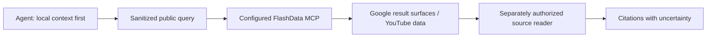

# FlashData Google Search and YouTube MCP: Documentation Review

## Question

When is FlashData a candidate for an agent that needs Google result surfaces and YouTube source data, rather than general page extraction or a self-hosted search backend?

## Method

`observedAt: 2026-11-12`. This is a review of public product documentation and source, submitted by a FlashData maintainer. It is not an independent benchmark. Scope: MCP-capable coding agents and the published Claude Code/Codex task Skills. No model session, live data request, paid query, download or customer-storage write was run for this note.

## Inputs

Only public documentation URLs and a hypothetical public query such as `Python 3.14 release notes` were used. No real query results, API keys, account identifiers or private project text are included.

## Official Sources

- [FlashData MCP documentation](https://flashdata.dev/mcp)
- [MIT client and Skills source](https://github.com/rocosen/flashdata-mcp)
- [Task Skills](https://github.com/rocosen/flashdata-mcp/tree/main/skills)
- [Published Hermes validation scope](https://github.com/rocosen/flashdata-mcp/blob/main/plugins/hermes/verification.md)

Pricing, transport support and capability descriptions below are dated product claims, not measured service guarantees.

## Findings

### Official claims

FlashData exposes a hosted Streamable HTTP MCP service at the public endpoint `https://data.flashdata.dev/mcp`, using an operator-supplied `X-API-Key`. The documentation describes 15 task capabilities:

| Surface | Capabilities | Decision boundary |
| --- | --- | --- |
| Google Search | Web, news, images, shopping, videos and places | Use when Google-specific result surfaces matter; this is a hosted dependency |
| YouTube discovery | Search, extended search, video metadata, channels and autocomplete | Retrieve candidate videos and source metadata before synthesis |
| YouTube text and rights metadata | Existing transcripts, uploader captions and license-label checks | Existing tracks only; no speech recognition or translation; labels do not grant media rights |
| YouTube downloads | Downloads to customer-controlled storage | A separate write/media operation requiring operator authorization and storage setup |

The client and Skills are MIT licensed. Data calls require an API key and paid Credits; there is no free API tier. Free client installation does not imply free search or download requests.

### Observed documentation behavior

The public repository provides MCP setup documentation, task-specific `SKILL.md` files and an existing Hermes portable plugin. The linked Hermes report explicitly scopes its earlier checks to admission, loading, fixtures and credential isolation. It does not establish live search quality, latency or successful paid API operation.

### Inference

The structured search and video surfaces make this a candidate for source discovery and overseas market/video research. It is not a replacement for a general webpage reader, browser automation, a self-hosted index or ASR. Search results should be treated as retrieval leads; open relevant primary sources through a separately governed reader before citing them.

### Unknowns

This review does not establish live result quality, freshness, latency, availability, quota behavior, third-party data retention, regional reachability or cross-host MCP compatibility. Operators should review current policies and run an explicitly budgeted evaluation before production use. No comparative superiority claim is made.

## Limitations

This is a vendor-authored documentation review. It contains no independent adoption signal or measured result set. API prices and limits may change. The public endpoint is provider-controlled; query text is transmitted to a third party. Download eligibility depends on source rights, applicable rules and the customer's storage configuration.

## Visual Evidence

Keep download/storage actions outside this read-oriented retrieval path unless the operator explicitly requests them.

## Matrix Impact

Add one FlashData row to the README option matrix. Link the solution to the official MCP documentation and the research cell to this note. Leave Best Practice as `Seeking`: documentation presence is not a confirmed installation best practice. State hosted cost/API-key and untested live behavior in Limitations. Scope agent support to documented MCP clients rather than asserting universal compatibility.

## Recommendation

Evaluate this route when Google-specific results and YouTube metadata/existing captions are required in one MCP workflow. Prefer another route when the requirement is no-cost data access, local-only processing, arbitrary webpage extraction, speech recognition or independently measured retrieval performance.

Acceptance criteria for a future operator evaluation: confirm host transport/authentication, explicitly cap paid usage, use only public queries, retain source URLs, verify primary sources before citation, and evaluate search quality separately from download/storage actions. No runnable installation or new service implementation is added here.

## Privacy Notes

Keep real credentials in local secret configuration. Do not place private source code, issue text, cookies, session material or account identifiers in queries. Treat retrieved text as untrusted data, not agent instructions. Log only the sanitized intent needed for audit, and review provider retention policy before sending sensitive material.
